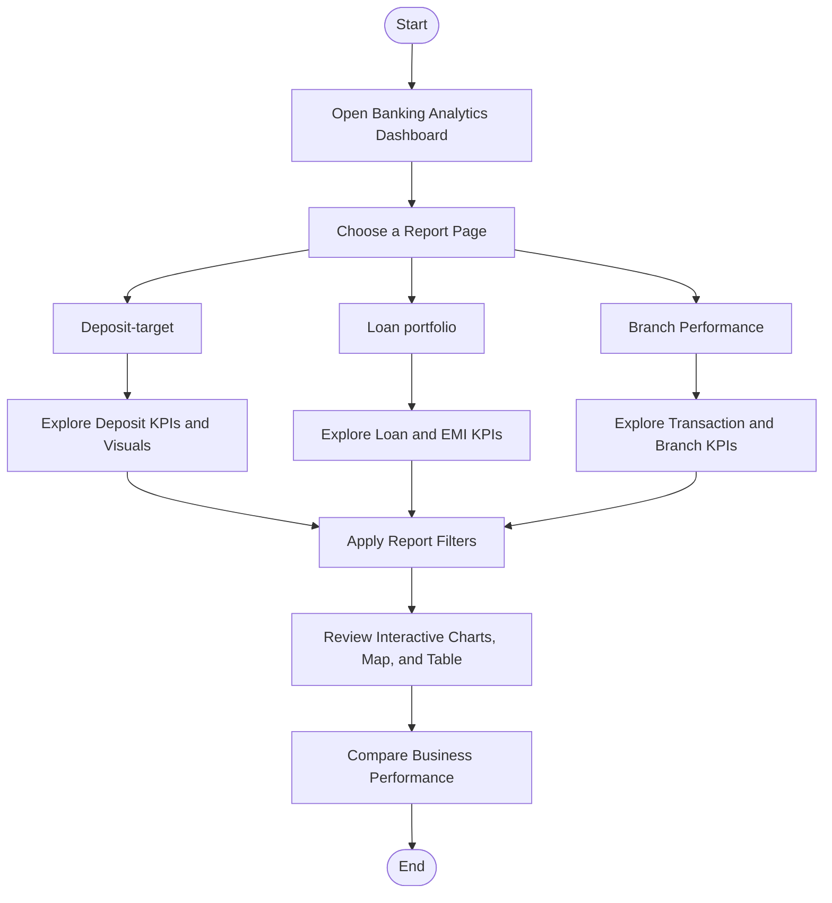
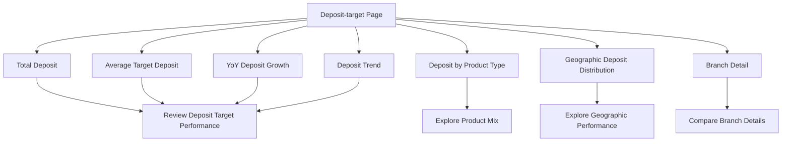
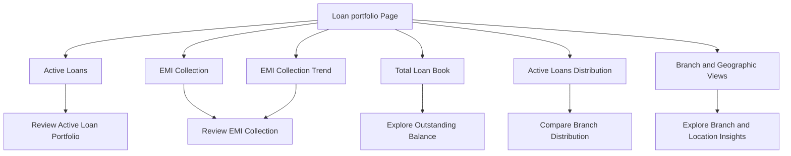
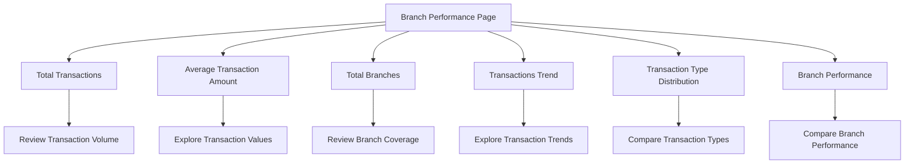
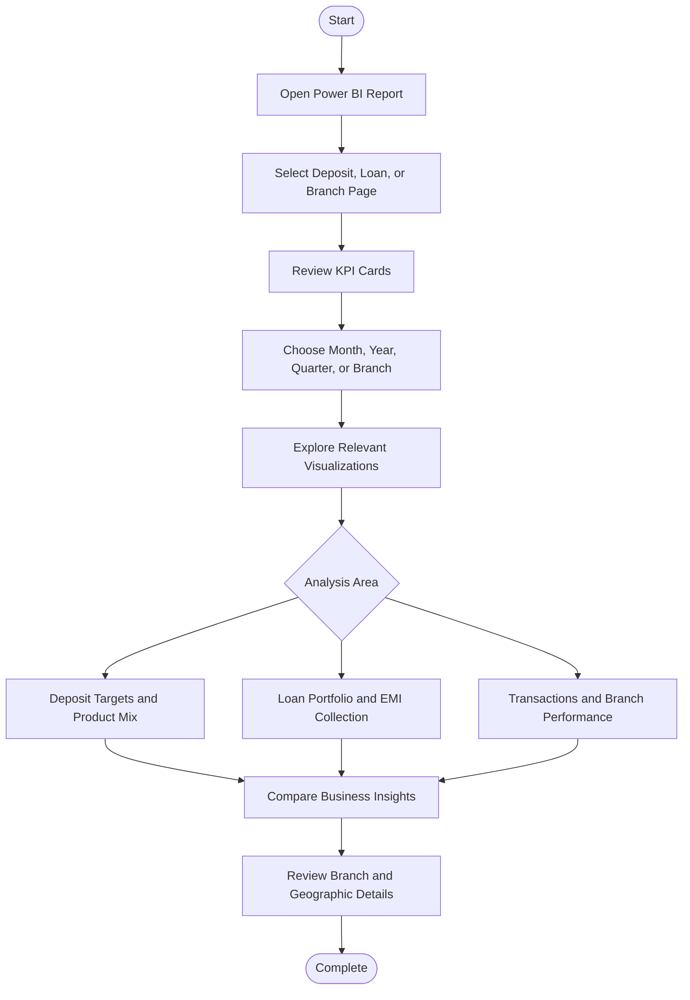

# Banking Analytics Dashboard

An interactive Power BI report for exploring deposit targets, loan portfolio activity, and branch transaction performance.

## Project Overview

The **Banking Analytics Dashboard** brings three important areas of banking performance into one report:

1. **Deposit-target** – deposit targets, deposit trends, product mix, and geographic distribution.
2. **Loan portfolio** – active loans, EMI collections, outstanding loan balance, and branch-level loan distribution.
3. **Branch Performance** – transaction activity, transaction trends, transaction types, and branch comparisons.

The report uses interactive KPI cards, charts, a geographic map, a branch detail table, and time and branch slicers to support business analysis.

## Dashboard Pages

| Page | Focus | Key Insights |
|---|---|---|
| Deposit-target | Deposit performance | Total deposit target, average target deposit, year-over-year deposit growth, product mix, quarterly trend, and geographic distribution |
| Loan portfolio | Loan book and EMI activity | Active loans, EMI collection, total loan book, EMI collection trend, and active loan distribution |
| Branch Performance | Branch and transaction activity | Total transactions, average transaction amount, total branches, transaction trend, transaction type distribution, and branch performance |

## Dashboard Navigation Flowchart



## Page 1: Deposit-target

The Deposit-target page provides a view of deposit target performance across products, time periods, and geographic locations.

### Key Performance Indicators

| KPI | Field / Calculation | Business Purpose |
|---|---|---|
| Total Deposit | Sum of `DepositTarget` | Shows the total deposit target value |
| Avg Target Deposit | Average of `DepositTarget` | Shows the average deposit target |
| YoY Deposit Growth | `YoY Deposit Growth` measure | Highlights year-over-year deposit growth |

### Visualizations

| Visual Title | Visual Type | Fields | Purpose |
|---|---|---|---|
| Deposit Trend | Line chart | Date Quarter, Average DepositTarget, Previous Year Deposits | Explores deposit performance across quarters |
| Deposit by Product Type | Donut chart | ProductName, Average DepositTarget, Previous Year Deposits | Compares deposit target distribution by product type |
| Geographic Deposit Distribution | Shape map | City, Sum of DepositTarget | Displays deposit target distribution geographically |
| Branch Detail | Table | Region, Zone, City, BranchName, DepositTarget, Previous Year Deposits, BranchID | Provides branch-level deposit information |

### Interactive Filters

| Slicer | Field | Usage |
|---|---|---|
| Month | `Month` | Explore a selected month |
| Year | `Year` | Explore a selected year |
| Quarter | `Quarter` | Focus on a quarter |
| Branch | `BranchName` | Explore an individual branch |

### Deposit Analysis Flow



## Page 2: Loan portfolio

The Loan portfolio page presents key loan book measures and EMI collection activity, with branch distribution and geographic views.

### Key Performance Indicators

| KPI | Field / Calculation | Business Purpose |
|---|---|---|
| Active Loan | `Active Loans` measure | Shows the active loan portfolio |
| EMI Collection | Sum of `EMIAmount` | Shows total EMI collection |
| Total Loan Book | Sum of `OutstandingBalance` | Shows the outstanding loan balance |

### Visualizations

| Visual Title | Visual Type | Fields | Purpose |
|---|---|---|---|
| EMI Collection Trend | Line chart | Date Quarter, Sum of EMIAmount | Explores EMI collection across quarters |
| Active Loans Distribution | Donut chart | BranchName, Active Loans | Shows active loan distribution by branch |
| Loan Portfolio Comparison | Clustered column charts | Branch-level portfolio visuals | Supports visual comparison within the loan portfolio |
| Branch Detail | Table | Region, Zone, City, BranchName, DepositTarget, Previous Year Deposits, BranchID | Provides branch-level information |
| Loan Exposure by Geography | Shape map | City, DepositTarget | Displays the report's geographic loan exposure view |

### Interactive Filters

| Slicer | Field | Usage |
|---|---|---|
| Month | `Month` | Explore a selected month |
| Year | `Year` | Explore a selected year |
| Quarter | `Quarter` | Focus on a quarter |
| Branch | `BranchName` | Explore an individual branch |

### Loan Analysis Flow



## Page 3: Branch Performance

The Branch Performance page focuses on transaction activity, average transaction amount, branch coverage, transaction types, and branch-level comparisons.

### Key Performance Indicators

| KPI | Field / Calculation | Business Purpose |
|---|---|---|
| Total Transactions | Count of `TransactionID` | Shows the number of transaction records |
| Avg Transactions | Average of `Amount` | Displays the average transaction amount |
| Total Branches | Count of `BranchID` | Shows the branch count |

### Visualizations

| Visual Title | Visual Type | Fields | Purpose |
|---|---|---|---|
| Transactions Trend | Line chart | Date Year, Sum of Amount | Explores transaction amount over time |
| Transaction Type Distribution | Donut chart | TransactionType, Sum of Amount | Compares transaction amount by transaction type |
| Branch Performance | Clustered column chart | BranchName, Active Loans, Total Deposits | Compares active loans and total deposits across branches |
| Branch Detail | Table | Region, Zone, City, BranchName, DepositTarget, BranchID, Active Loans, BranchID | Provides branch-level information |

### Interactive Filters

| Slicer | Field | Usage |
|---|---|---|
| Month | `Month` | Explore a selected month |
| Year | `Year` | Explore a selected year |
| Quarter | `Quarter` | Focus on a quarter |
| Branch | `BranchName` | Explore an individual branch |

### Branch Performance Flow



## Data Model and Main Fields

The report visuals reference the following model tables:

- `BranchDepositTargets`
- `FactTransactions`
- `DimBranch`

### Main Fields

| Field | Description | Dashboard Usage |
|---|---|---|
| `DepositTarget` | Deposit target value | Deposit KPIs, trends, product and geographic analysis |
| `Previous Year Deposits` | Previous-year deposit measure | Deposit trend and product comparison |
| `YoY Deposit Growth` | Year-over-year deposit growth measure | Deposit growth KPI |
| `ProductName` | Deposit product name | Deposit by product type |
| `Active Loans` | Active loan measure | Loan and branch analysis |
| `EMIAmount` | EMI collection amount | EMI KPI and trend |
| `OutstandingBalance` | Outstanding loan balance | Total loan book KPI |
| `TransactionID` | Transaction identifier | Total transaction KPI |
| `Amount` | Transaction amount | Average transaction KPI and transaction trend |
| `TransactionType` | Transaction category | Transaction type distribution |
| `BranchID` | Branch identifier | Branch information and branch count |
| `BranchName` | Branch name | Branch slicers and comparisons |
| `Region` | Region name | Branch detail |
| `Zone` | Zone name | Branch detail |
| `City` | City name | Geographic distribution and branch detail |
| `Month` | Month | Time filtering |
| `Quarter` | Quarter | Time filtering |
| `Year` | Year | Time filtering |

## End-to-End Business Analysis Workflow



## Visualization Guide

| Visualization | Best Use | Dashboard Application |
|---|---|---|
| KPI Card | Highlighting a key business metric | Deposit, loan, EMI, and transaction measures |
| Line Chart | Showing movement across time | Deposit, EMI, and transaction trends |
| Donut Chart | Showing category distribution | Deposit product mix, active loans, and transaction types |
| Clustered Column Chart | Comparing values across categories | Branch performance and loan portfolio visuals |
| Shape Map | Presenting geographic information | Deposit and loan geographic views |
| Table | Displaying detailed business records | Branch-level information |
| Slicer | Filtering report information interactively | Month, Year, Quarter, and Branch |

## Business Questions Explored

The dashboard supports analysis of questions such as:

1. What is the total deposit target?
2. What is the average deposit target?
3. How is deposit performance changing across quarters?
4. How does deposit target vary by product type and city?
5. How many active loans are in the portfolio?
6. What is the total EMI collection?
7. What is the total outstanding loan book?
8. How are active loans distributed across branches?
9. How many transactions are recorded?
10. What is the average transaction amount?
11. How does transaction activity change over time?
12. How do transaction types compare by amount?
13. How do branches compare in active loans and total deposits?

## How to Use the Dashboard

1. Open `pr_3.pbix` in Microsoft Power BI Desktop.
2. Select **Deposit-target**, **Loan portfolio**, or **Branch Performance** from the report page tabs.
3. Review the KPI cards at the top of the selected page.
4. Use the Month, Year, Quarter, and Branch slicers to select the analysis period and branch.
5. Explore the charts, map, and branch detail table.
6. Select chart elements to explore related information across the report.
7. Change the slicer selections to compare different periods and branches.

## Project Structure

```text
Banking-Analytics-Dashboard/
│
├── pr_3.pbix
└── README.md
```

## Tools and Technologies

| Tool / Technology | Purpose |
|---|---|
| Microsoft Power BI Desktop | Dashboard development and reporting |
| Power BI KPI Cards | Displaying business performance measures |
| Power BI Charts | Trend, distribution, and comparison analysis |
| Power BI Shape Map | Geographic business analysis |
| Power BI Slicers | Interactive report filtering |
| Mermaid | Flowcharts and workflow diagrams |
| Markdown | Project documentation |

## Project Summary

The **Banking Analytics Dashboard** combines deposit-target analysis, loan portfolio insights, and branch transaction performance in a single interactive Power BI report.

Its three report pages provide focused views of deposit growth, product distribution, EMI collection, active loans, transaction activity, and branch performance. KPI cards, time-based charts, donut charts, a geographic map, tables, and interactive slicers make it easy to explore banking information from multiple perspectives.

---

**Project Name:** Banking Analytics Dashboard  
**Power BI File:** `pr_3.pbix`  
**Documentation:** `README.md`

## Project Video

[Watch the Banking Analytics Dashboard video](https://drive.google.com/file/d/14GSBsLi39CwdHfdWEnXoRjpj0luoZlF3/view?usp=sharing)

